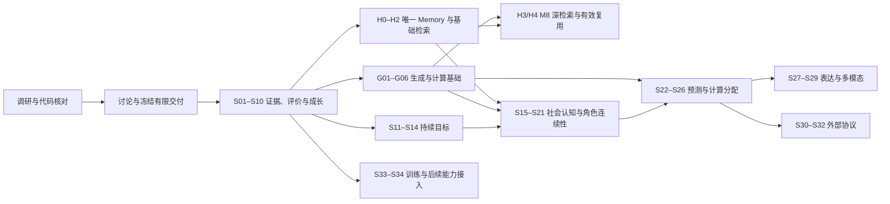

# Atria Agent Intelligence Runtime — 正式架构与阶段入口

> 执行规则统一见 [Governance](../../../README.md)。本 Bundle 管理产品设计、依赖和实际验证；历史工程数字不构成当前配额、测试许可或人工审批。

- Task ID: `agent-intelligence-runtime`
- Primary Workspace: `main`
- Status: 当前已选有限交付与收尾完成；main 已从 `3ee1332ef` 快进集成至 `f4815c727`。S11–S34、G01–G06 的所选消费者及必要实际出口按同一 Record 的有限证据交付；S34 双域 pilot 均 tie、未发布，S25 无质量收益、S26 未证明成本改善。当前集成不等于完整 M4–M8 / HM2–HM3 的泛化收益或所有可选能力验收；逐项边界见下方状态表与 Record 最终收尾节。
- Updated: 2026-10-13
- Private storage checkpoint (2026-10-12): 按当前用户批准完成本地私有资料精简；历史逐次原始材料/迁移副本已移出工作目录，仅保留当前连接、极小滚动限流状态与阶段摘要。后续测试保留规则只归 [Governance §13.1](../../../README.md#131-api-测试执行规则)，实际清理与证据限制见 Record 最新节；该历史清理不改变后续实际交付，也不为补已删除原始材料重跑历史阶段。
- Historical checkpoint (2026-10-12): source `5a80e1563b1e9db4150da98d0096bdc61704d3f9` 与远端一致，已恢复当前完整私有 RAR。沿原作者 `system.style` 隔离 revision v3 完成 Session 三臂及四既有 frame 最小复验：7 HTTP200 的有限无依据场景/时间/玩家自主权项通过，2 TLS transport unknown/旧天气 FAIL 保留；原bank、authority 与产品源码未改。Session原三臂累计27 jobs，完整G06/M8/HM2与M3前置不变；叙事六维/独立盲评、真实语义/费用收益未宣称通过。最新实际证据见Record，不重跑已完成Session Task冷恢复或M1/HM1。
- Historical G06 consumer checkpoint (2026-10-12): source `4160851ca` 已push；World解释policy保留字段定义、未知事件和位置归属，不把scene位置分配给Actor/玩家。原六维/格式失败/新ownership不利结果及全部费用保持，当前受影响质量项已完成修正与配对，所选G06技术验收通过，完整M8/HM2尚未集成main；见 [G06矩阵](g06-acceptance.md) 与最新Record。M3已采用原作者/作品授权可见范围与接管，入口设计见 [M3](m3-cognition-design.md)，S15按 [具体契约](s15-actor-identity.md)交付有限身份消费者，S16有限消费者与三模式Disclosure正文出口通过，原9条失败与费用保留；S17有限Desire/Intention与原Goal/commitment关联已交付（source186c449fa）；S18有限共享事件appraisal已交付（sourcefbe0f5b7a），15新增/4受影响本地PASS及两实际HTTP200/direct7236；后续正文为明确本地重放consumer、原完整appraisal normalized快照缺失保留，详见 [S18](s18-event-appraisal.md)/最新Record。S19有限一阶/二阶ToM及同Session行为反例后正文出口完成（sourcee39a425a9），19新增/2受影响本地PASS；2HTTP200/direct8593与1HTTP400/unknown upper6261全部保留，见 [S19](s19-theory-of-mind.md)/Record。S20有限因果轨迹/Memory applicability/轻度默认与深度可选遗忘出口完成（source9736eabd5），12新增/2受影响本地PASS与一次HTTP200/direct5955；见 [S20](s20-memory-applicability.md)/Record。S21起的后续交付见下方当前状态表。
- S01 implementation / baseline Tested HEAD: `0a41023ef6689b8b80ca64ffdd5cda72838897fe`；`feat/agent-intelligence-runtime` 已 push，尚未合并 main。
- S02 implementation / Tested HEAD: `072a15d8d5b51117d0c5442e48e345475a274b66`；沿用同一任务分支，已 push，main 未变化。
- S03 implementation / Tested HEAD: `78acfb65da6b1afa1dee1c2f35482af215832c74`；沿用同一任务分支，已 push，main 未变化。
- S04 implementation / Tested HEAD: `172a0c281334c36c56273a24d19922ad4d5e5c35`；沿用同一任务分支，已 push，main 未变化。
- S05 implementation / Tested HEAD: `caf662842941d3261dc1840242278f5529db10af`；同一任务分支已 push，main 未变化。
- S06 implementation / local Tested HEAD: `54c79cb8eea7d6ca5c7e5e4ff262fe0ca6666a64`；六槽真实基线 / 六对独立比较已完成，101 distinct local tests；typed judge五个有效观察 / 一个无效响应，候选仍 promotion ineligible。实际模型报告 pin 各自 tested HEAD / source bytes，见 Record。
- S07 implementation / local Tested HEAD: `57f4e814af373b4659ba247f9891edd80652c356`；完整 Skill snapshots / candidates / CAS 与真实读取 pin；13 relevant suites / 247 distinct tests，未执行真实模型或自动 publication。
- S08 implementation / local Tested HEAD: `9b5cb5740e2af7cab8b83b9675576ea01c4f4527`；Native Prompt immutable candidates / Route CAS 与 ordinary RP Workspace exact binding；7 relevant suites / 68 distinct local tests，未执行真实模型或自动 publication。
- S09 implementation / local Tested HEAD: `f740e65238d6c46575c1f9972735a1166ca1ec71`；Workspace 编排参数 exact versions / rollback 与 Project pristine Task repair 参数候选 / 原 CAS；8 relevant suites / 105 distinct local tests，无新真实模型。
- S10 implementation / local Tested HEAD: `ed00f4f0cea53be360ed8dfa082bbd0afeec5398`；有限 Evolution / owner budget / 隔离 evaluator / 原局部 publication / 恢复 / shared UI；12 suites / 233 distinct local tests，实际模型改善待验收。
- F1 implementation / local Tested HEAD: `57520d43dd577c13d1eee6df50d3edb4a3379a1e`；原Experience v2、零模型采集、归因路由、固定quality/Report消费者；5相关suites / 101 distinct local tests及共享pane Chromium fixture通过。paid source仍a61b249ef，F2准备核对source_unready，独立来源/实际语义校准未完成；F3未开始，M1 pending。
- F2 previous paid / local Tested HEAD: `eb1664138458ebae073d86792e5a5295ce27dfda`；独立来源密封保持；授权探测新增22请求/140750 tokens，RP校准12/12与3基线完成，Project第4校准因解释552>512无效，首失败停止。累计783/3080332，headroom未建立、F2未验收、F3未开始；详见feedback§12/acceptance§10.4。
- F2 primary checkpoint / local Tested HEAD: `f495267023ca4475d15ba1c61b66702624c4938e`；新来源/独立密封/范围固定完成主模型测试；20/20 有效 controls、六真实基线原硬检查通过，RP knowledge / Project status 主模型缺口成立。第二模型复核暂缓，F3 未开始，M1 pending。实际结果与 pins 见同一 Record 最新节。
- F2 dual source completion / local Tested HEAD: `11756061ed74dc298ab99f0701b1d7e7c1c0a607`；两域40/40有效controls与六来源各两观察完成，原六基线复用；两域共同缺口成立。
- F3 product / local Tested HEAD: `cebd14154b371f59a7b44dbac9726e2f9db18a4c`（已push）；一次双域提炼/development完成，两域一致candidate胜均0，存在重要维度负差/分歧与一份无效评价，未准入promotion，M1 pending。最新F3 17/17与retry18/18本地checks；具体实际结果/pins见同一Record。
- M1 current checkpoint: M1实际验收与main集成完成。Project开发三胜、独立九胜；RP开发3胜、独立3胜/3对，相关六维无负差，三条公开回复完整152条核验六维met。两域完整费用绑定、native review发布、下一真实请求精确消费和guarded rollback均通过。main `ea75b76be4927e881de2f0be7c304a56301f1f83`；原生产自动发布规则、历史不利结果和unknown费用保留。M1 未重跑；HM1 当前交付另见下项。
- HM1 current checkpoint: H0 `722f1d698` / H1 `b8c2a85e6` / H2 `3ee1332ef`，已从上述 M1 main 连续交付并 fast-forward 集成 main。B0 原始不利观察保留；B1–B3 合法域、中文种子与完整来源组配对完成，ordinary RP/Game/Package 实际消费。9组同主模型正文盲评的六维总分不低于 B1，个例不足及长篇无依据“记得”原输出保留，并完成一次触发式有界修正审查。完整证据、费用与限制见同一 Record 最新 HM1 节；不声明自由文本绝对保证、真实 Embedding 收益或 HM2/HM3 完成。
- D0/D2 inspected product HEAD: `ed1fd90521a63363e29856601abbf5e908c99d10`；D5 最新 main `6ab12ba43c5b18bfec6df75c16456a4cb4497d3f` 与当前开发分支 `25e1aef0f2ed6e209520a9883fb9527c0bff24cf` 已静态核对，范围与限制见 [baseline §10](baseline.md#10-d5hybrid-memory-整合时的实际基线)。
- Source research: [Frontier Agent RP 调研](../agent-intelligence-research.md)；[Prompt / Context](../model-prompt-context-frontier-research.md)、[Sparse AI / Compute](../sparse-ai-invocation-adaptive-compute-research.md)、[Model / Provider / Routing](../model-provider-routing-frontier-research.md)、[Reasoning Continuity](../reasoning-continuity-research.md)、[Execution Reuse / Cache Locality / Adaptive Invocation](../execution-reuse-cache-locality-adaptive-invocation-research.md)、[Hybrid Cognitive Memory 2.0](../hybrid-cognitive-memory-2-0/index.md)
- D2 source docs HEAD: `40ce08a32`；产品基线未变化。
- D4 source docs HEAD: `1c2502dae8ac1bcb7a0bb1dfb1e18d9f01b984b8`；研究源提交 `aa4d2d2fe`，S03 产品 HEAD 与 main 未变化。
- D5 source / integration start docs HEAD: `13d09ccac68b2c4f71f84a8ae2a405f3eb53577b`；HCM-01–08 最终决定已冻结，本轮只整合 docs，产品 refs 与 M1 历史不变。
- M8 historical checkpoint: 从 main `3ee1332ef` 在 `feat/agent-compute-runtime` 推进；G01 基础 `c62ecc937`、G02 编译绑定 `37273d4ca`、G03 Artifact/Plan proof `c6979abda`、G04 Responses/stream `09ef28452`、原生私有 envelope/Host retry `47575e344`、G05 shared send `9599dad35`、gateway counters `acd2d563f` 与原Studio Task lineage消费者 `9369f3b0a`，未集成，完整 M8/HM2 尚未验收。实施矩阵见 [G01 substrate](g01-substrate.md)，持续按 G01→G06→HM2 依赖推进。
- Record: [阶段记录](../../../records/refactor/agent-intelligence-runtime.md)
- M2 historical checkpoint: S11 `9b0ad933f` / S12 `3ee22238e` / S13 Project `fdea2011b` / S14 scoped RP events and shared pane `0c50438f6` 已 push。有限双入口 Source 完成、原 bank 和用户控制已验证；RP 不从 Goal 文本创建隐藏 Task/Run，关闭应用期间无系统唤醒。实际支持及证据边界见 [S13](s13-goal-continuation.md) / [S14](s14-goal-experience.md) 和最新 Record。M8/HM2 的 G06 真实出口仍未验收，M3 前置保持。

## 目标与当前结论

把 Atria 已有的执行、记忆、世界权威与编排能力连接为持续智能体闭环：

`观测与证据 → 认知／目标 → 决策与执行 → 正式结果 → 评价与经验 → 经验证的改进`

**角色 RP 与 Project Agent 并重**是用户在本次对话中明确确认的产品选择。
两条入口共享证据、评价、目标和改进契约，各自保留当前写入权威、运行入口与产品体验。

D2 将三份研究纳入同一正式架构：稳定 Behavior / Creative 语义、受权限控制的 Context、稀疏计算准入、请求时 Routing 求解与精确执行证据共同服务该闭环。架构层不等于模型调用层，ordinary RP 以一次主要正文调用为目标，额外计算必须有触发证据与预算。

D3 将 Reasoning Continuity 纳入现有 Runtime 的可选执行能力，沿 Provider Adapter、Capability Evidence、Effective Execution Plan / Snapshot 与 ExecutionObservation 管理，详细规则唯一归属 [model-routing §7](model-routing.md#7-reasoning-continuity执行状态与生命周期)。它保留兼容路径的不透明状态；长期成果走显式 artifact 原契约，Planner 与 Narrator 分别评价目标连续和表达新鲜。

D4 将已完成工作的有效复用、稳定 Context 与缓存局部性接入同一链路：[execution-reuse](execution-reuse.md) 唯一管理 Reuse Contract / validity proof / dependency invalidation 与 Tool / Plan 消费；[behavior-context §3.1 / §4](behavior-context.md#31-稳定-context-segment-与-cache-aware-compiler) 管理 Segment identity / canonical compiler；[compute-policy §1.1](compute-policy.md#11-adaptive-invocation-决策阶梯) 管理按需执行；[model-routing §8](model-routing.md#8-cache-capability与cache-locality) 管理三层 cache capability / locality 与可观察执行。相似度只找候选，原 authority 证明当前适用；RP 复用前置 facts / plan / intent 并 fresh-generate 正文。Execution Continuation 引用 D3，详细定义不重复。

D5 采纳 HCM-01–08，正式检索与硬切换的唯一详细权威为 [hybrid-memory](hybrid-memory.md)：来源 / Actor / 时间 / Branch 先形成合法候选域，再廉价混合、按需升级和证据覆盖，最终经原 Context 消费。旧独立 LLM/RAG UI / 配置 / 执行链已在 H1 硬切换删除；有效 Atria 原生来源保留、派生索引重建，不做旧模式双读双写。旁白 B / A、C、事件驱动认知、角色遗忘、正式 World Tick 分别纳入原 Context / Actor / Simulation 职责，预算与缓存沿原 Compute / Reuse / Routing。未实施的质量、成本与时延收益均保持待验证。

主线不是缺一种编排模式。当前最重要的缺口是跨运行的可信证据与评价、持久目标、可追溯的角色认知，以及它们与既有 authority 的连接。
建议先完成两条入口都能实际使用的 Experience / Eval / Evolution 交付，再进入目标和社会认知。模型 / 网关 / 计算基础以新增有限交付组 M8（G01–G06）补齐，之后社会认知与预测消费共享 substrate；前沿技术通过有消费者的 adapter 接入。

## 已确认与未冻结

已确认：先调研、讨论、定案、执行；RP 与 Project Agent 并重；首批 Skill / Prompt / 编排参数成长闭环包含有预算与回滚约束的局部自动启用；M1 完整交付后集成，再从最新 main 继续。

D1 已确认逐角色 / Project 开启局部自动，新建对象默认审阅，共用 owner 级有限预算。M1 产品边界与架构执行约束已冻结，S01 设计就绪。
后续物理 schema、具体预算 / 阈值、迁移和认知具体权限按对应阶段深化；HCM-01–08 的产品方向已冻结，不重新讨论。正式采纳范围由 [decisions.md](decisions.md) 管理，八项决定的最终语义引用原 Hybrid decisions。前六份研究与 Hybrid Bundle 是来源材料；被正式采纳的架构约束由对应模块管理，其余研究建议不构成实施批准。D2 / D3 / D4 / D5 只授权企划更新，不把研究统计、示例 schema、候选名称、Provider 支持或新自动化权限当作用户批准；G01–G06 与 H3–H5 未实施；H0–H2 实际交付以同一 Record 为准。

## 模块图与阅读路由

| 模块 | 唯一详细职责 | 依赖 |
| --- | --- | --- |
| [baseline.md](baseline.md) | main 的代码事实、接入点、现有测试与缺口 | inspected HEAD |
| [research.md](research.md) | 一手资料复核、证据边界、原研究需要收窄的推论 | 原研究、baseline |
| [architecture.md](architecture.md) | 六 Plane 与语义 / 复用 / 计算 / 路由 / Memory 连接、证据 / 认知 / World Tick 边界 | baseline、decisions |
| [delivery.md](delivery.md) | 40 个候选实施阶段、HM1–HM3 有限工作包、依赖、实际交付与验收 | architecture、research |
| [decisions.md](decisions.md) | 架构选择、建议与待定事项 | index |
| [m1-acceptance.md](m1-acceptance.md) | M1 当前测试执行、自动化工程验收与历史结果；生产 human gate 不变 | m1-evolution、s10-evolution、当前阶段范围 |
| [m1-feedback-evaluation.md](m1-feedback-evaluation.md) | U13确认的原链路反馈来源、根因/干预分离、质量/案例/评价版本契约及双域试点工作包；F1/F2前置范围完成；F3一次双域试点未准入promotion，M1 pending；当前结果见feedback§15/同一Record | S05、S10、m1-acceptance、领域扩展研究 |
| [m1-evolution.md](m1-evolution.md) | 首批双入口成长、局部自动启用与恢复的具体讨论设计 | architecture、decisions |
| [s01-baseline.md](s01-baseline.md) | S01 的具体案例、报告契约、预算、验证和退出条件 | decisions、当前代码入口 |
| [s02-sources.md](s02-sources.md) | S02 最小 source / reference / validity、预算与无迁移边界 | m1-evolution、当前 authority |
| [s03-capture.md](s03-capture.md) | S03 bounded RP trace / EvidenceRecord、key / CAS、outcome / output binding、迁移与缺失边界 | s02-sources、原 StorageEngine / authority |
| [s04-project-recovery.md](s04-project-recovery.md) | S04 持久 Project task / attempts / public conversation、正式 Git receipt、容量 / restart / conflict / delete | s02-sources、s03-capture、原 Studio / StorageEngine |
| [s05-feedback.md](s05-feedback.md) | S05 feedback / diagnosis 分层、subject / exact source、撤回 / 删除 / 导出、retention / reflection batch | S02–S04 与原 StorageEngine / authority |
| [s06-comparison.md](s06-comparison.md) | S06 隔离比较 / explicit live bridge / 共享累计预算 / 真实执行与保守晋升状态 | S01、S05、原 Workspace / Session / generation |
| [s07-skills.md](s07-skills.md) | S07 原 Skill repository immutable snapshots / candidates、完整 base conflict、真实 run pin / history / lifecycle | S06 与原 Skill authority |
| [s08-prompts.md](s08-prompts.md) | S08 Native / Workspace Prompt body candidates、声明 / exact refs / diff、局部 binding / conflict / next preparation | S06 与原 Prompt / Preset authority |
| [s09-strategies.md](s09-strategies.md) | 有限编排参数、whole base / 局部 exact binding、pristine Project Task / conflict / rollback | m1-evolution、原 Workspace compiler / Project task policy |
| [s10-evolution.md](s10-evolution.md) | 共享有限预算、source / policy validity、隔离评测、局部 publication / rollback / 消费证据、双入口 UI 与支持矩阵 | S05–S09、原 scheduler / authorities |
| [behavior-context.md](behavior-context.md) | Behavior / Creative / Context / Generation 分层、语义编译、overlay、压缩与迁移 | 当前 Prompt / Context substrate |
| [compute-policy.md](compute-policy.md) | sparse 默认路径、共享 cognition、硬预算、后台分流与计算收益评价 | TaskScheduler / RunControl、M1 Eval |
| [g01-substrate.md](g01-substrate.md) | 当前 M8 基础 binding/policy schema、有限支持矩阵与未测边界 | delivery §8、model-routing、原 Runtime |
| [g06-acceptance.md](g06-acceptance.md) | 所选消费者、质量/成本/时延/unknown出口及当前不利观察 | delivery、compute-policy、同一Record |
| [s16-belief-disclosure.md](s16-belief-disclosure.md) | 原Information cognition/独立Disclosure实施与保证等级 | S15、H2、M3权限 |
| [s17-desire-intention.md](s17-desire-intention.md) | 原Desire/Intention与Goal/commitment关联 | S11–S12、S16 |
| [s18-event-appraisal.md](s18-event-appraisal.md) | 获准事件共享appraisal、动态情绪/方向关系与原费用 | S16、S17 |
| [s19-theory-of-mind.md](s19-theory-of-mind.md) | 观察Actor自己的有界一阶/二阶推测与获准行为反例 | S18 |
| [m3-cognition-design.md](m3-cognition-design.md) | 已明确的原作者/作品授权可见范围与接管、S15有限入口 | decisions R5、G06、原Actor/Information/Context |
| [s15-actor-identity.md](s15-actor-identity.md) | 精确Actor/旧profile分类投影与原Context身份consumer | 已验收G06、M3入口权限、原Actor/Information |
| [model-routing.md](model-routing.md) | Connection / Target / Identity、动态 evidence / policy / resolver、gateway、恢复与执行观察、Reasoning Continuity、cache capability / locality | 既有 resolver / provider ports、Context / Compute / Reuse 契约 |
| [execution-reuse.md](execution-reuse.md) | 复用定义 / proof、依赖级失效、Tool / Artifact / Plan / Workflow / Narrative Intent 消费、Trust Domain 与评价 | 原 artifact / source / authority；Context / Compute / Routing 分别管理执行连接 |
| [hybrid-memory.md](hybrid-memory.md) | 唯一 Hybrid、合法候选域 / query / typed evidence、三条生成路径、旧 LLM/RAG 硬切换 / 原生来源 / 索引、失败与验证边界 | 原 Memory / Information / Authority / Context / Compute / Reuse / Eval；HCM-01–08 |
| [h0-baseline.md](h0-baseline.md) | H0 准备时固定的调用图、anchor、旧模式清单与样本规格；历史快照，实际 B0 和交付见 Record | delivery §8.2、hybrid-memory、baseline §10 |

S01–S10 和 M1 已交付并集成 main，当前有限组 HM1 也已完成。M1 历史准入、不利结果与费用只从 m1-acceptance、m1-feedback-evaluation 和同一 Record 追溯；历史 pending / ineligible 不改写为通过，也不恢复为当前执行限制。无需重跑 M1 或读取独立密封正文。实际 Git 和本入口的 HM1 checkpoint 管理当前状态；HANDOFF 生命周期只引用 Governance。
后续阶段的最小读取集合由 delivery 路由，不要求每次重新加载整份原始研究或全部 Bundle。

Hybrid 后续读取：本入口 → decisions §9 → delivery §8.2 → hybrid-memory 当前工作包章节 → baseline §10 / 对应原消费者。只有选择算法 / 冻结基准时再读 research §7 和原检索研究 §8；完整 HCM 技术建议不再作为第二份正式详细规则。M1 已独立验收完成；H3–H5 的进入条件仍由 delivery 管理，不把 HM1 完成解释为远期能力交付。

H0 原准备快照见 [h0-baseline](h0-baseline.md)，原冻结样本 bytes/hash 保留。实际 B0、HM1 三路径消费者、配对正文、失败修复与费用见 [同一 Record](../../../records/refactor/agent-intelligence-runtime.md#hm1--h2-中文种子完整来源组与正文配对)。M1 当前门槛与历史报告保持。

## 阶段图

图中是建议的产品演进路线，不是已冻结的执行次序。精确依赖见 delivery；M5、M6、M7 可以在满足自身依赖后调整顺序。
保留 S01–S34 身份，新增 G01–G06 共 40 个候选实施阶段。建议 M1 → M2 → M8 → M3 → M4；M8 与 M2 没有必然先后依赖，可在本组设计时调整，M3 前必须有已验收生成基础。M1 不等待 M8，也不在 S01 中实现动态路由。
远期技术成熟度不构成第一批产品交付的隐含依赖。
D4 的 Reuse semantics → Cache-aware context → Tool / Artifact → Plan / Workflow → Adaptive Invocation → Local optimization 映射见 [delivery §8.1](delivery.md#81-execution-reuse实施顺序与既有阶段映射)；前五项沿 G01–G06，Local KV / decode 在后续研究池，保持 40 个正式阶段身份。

D5 的 HM1（H0–H2）在 M1 原验收 / 集成后作为有限 Memory 重构，HM2（H3/H4）映射 M8 的 proof / Context / Routing / G05 / G06，HM3（H5）随 M2/M3 与原 Simulation 完成，S25/S26 / S27 后续深化计算 / 表达。H1/H2 不依赖完整 M3 或新 Goal writer，H3/H4 不互为前置，H5 不额外等待全部深检索算法或缓存数值收益；精确依赖及每组出口唯一见 [delivery §8.2](delivery.md#82-hybrid-memory有限交付组与依赖)。这些是工作包，不增列 S/G，也不延期 M1。

## 当前状态

当前集成 HEAD 为 main `f4815c727`；以下 source 提交与检查数字为各阶段的实际证据，顶部历史 checkpoint 不恢复为当前状态。未选扩展和未证明的收益保持原边界，不影响本次有限交付收尾。

| Checkpoint | 状态 | 产物 |
| --- | --- | --- |
| D0 — 重新调研 | 已完成本轮架构覆盖；进入讨论 | 代码审计、一手资料复核、34 阶段讨论稿 |
| D1 — 确定方案 | 已完成本轮冻结 | 默认模式、scope / budget / publication 约束、S01 执行设计 |
| D2 — 三份研究综合更新 | 本轮完成 | 三个权威模块、六个基础阶段、依赖与评价 / 测量补充 |
| D3 — Reasoning Continuity 架构整合 | 本轮完成 | 既有术语归并、opaque execution / lineage / loss、G01–G06 实施映射与评价边界 |
| D4 — Execution Reuse / Cache Locality / Adaptive Invocation 整合 | Complete；本轮仅企划 | 复用契约、Segment / canonical compiler、按需调用、路径 cache evidence 与 A–F 映射；continuation 沿 model-routing §7 |
| D5 — Hybrid Cognitive Memory 2.0 正式整合 | Complete；仅企划，未实现 / 未实测 | 八项冻结决定、唯一 Hybrid / 硬切换范围、原权威消费者、HM1–HM3 / H0–H5 依赖与逐包验收；M1 pending 与不利证据保持 |
| S01 | 原结构阶段 complete；S06 live pilot empiricalReady=true | 12 cases、双入口 runner、strict v1 consumer / sidecar、有限预算与缺失状态；实际验证见 Record |
| S02 | Complete；只读来源契约与 consumer | 双域 adapter、EvidenceSet / Evaluation v1；43 新增 / 17 既有 tests 通过；无持久资源或迁移 |
| S03 | Complete；可靠 RP 捕获与公共持久层 | bounded metadata、run / request / attempt / variant、Native receipt、FS / SQLite durable CAS 与 authenticated consumer；验证见 Record |
| S04 | Complete；Project 持久任务与恢复 | FS / SQLite task / attempts / conversation、正式 Studio Git receipt、保存失败恢复 / stale conflict；9 suites / 165 distinct tests 与本地 Chromium fixture 通过 |
| S05 | Complete；双入口反馈与诊断生命周期 | exact source / subject、CAS、纠正 / 撤回 / 删除 / 导出、retention / reflection；5 suites / 137 tests |
| S06 | Complete；隔离 evaluator 与真实执行 checkpoint | 六槽 pilot / 六对独立比较全部 execution / authority passed；5 model observations / 1 invalid response；候选晋升 ineligible |
| S07 | Complete；原 Skill authority candidate / version / read pin | full-file history、正文候选 / whole-base CAS、RP shared run / Native / Studio exact consumers；13 suites / 247 tests |
| S08 | Complete；原 Prompt / Preset authority body candidate / exact binding | Native immutable closure / Route CAS、ordinary RP Workspace pin、下一 request / run 消费；7 suites / 68 tests |
| S09 | Complete；原 Workspace 参数 exact binding / rollback、Project pristine Task repair candidate / CAS | 8 suites / 105 tests；单字段 / whole base / conflicts；运行开始后 Project 不热改，手动 apply 无晋升资格 |
| S10 | 工程交付及两域M1实际验收完成 | 原六类局部 target、有限 owner ledger、隔离 evaluator、publication / recovery / next-run evidence、共享面板；12 suites / 233 tests |
| M1反馈/评价补充 F0–F3 | Complete；实际双域验收与main集成完成 | 相关真实语义、完整费用与原生命周期通过；历史不利结果保留，具体版本见Record最新节 |
| S11 | 有限持久/控制出口已交付 | [s11-goals](s11-goals.md)，S12证据、S13持久续跑和S14体验已接；有限范围见各入口与Record |
| S12 | 有限criteria/完成证据与失效出口已交付 | [s12-goal-evidence](s12-goal-evidence.md)，14新增/12受影响既有distinct本地PASS；Actor认知完成留S17 |
| S13–S14 | 有限用户/作品事件出口已交付 | [s13-goal-continuation](s13-goal-continuation.md)、[s14-goal-experience](s14-goal-experience.md)，同Task bank/恢复、显式RP事件和共享pane；非应用关闭唤醒或Actor欲望验收 |
| G01–G06 | 所选技术矩阵与有限消费者已集成；完整M8收益未验收 | 当前入口[g01-substrate](g01-substrate.md)及[g05-transformers-embedding](g05-transformers-embedding.md)；`84fca4a73`补原Session声明Task native冷恢复及完成工作解释、原Gemini实测同bank通过；原source/预算/复用、本地语义、SSE观察已补，原FAIL和完整费用/收益缺口保留 |
| S15 | 有限身份与profile投影交付 | [s15-actor-identity](s15-actor-identity.md)，8新增/4受影响既有本地检查；精确Host/模型切换/安装版本/分支恢复消费 |
| S16 | 有限消费者与正文Disclosure出口通过 | [s16-belief-disclosure](s16-belief-disclosure.md)，原13新增/8受影响及当前6本地检查PASS；原9正文FAIL保持，修复后3模式正文有限通过/新增direct7135 |
| S17 | 有限Desire/Intention与Goal/commitment关联交付 | [s17-desire-intention](s17-desire-intention.md)，22新增/7受影响本地PASS；4正文/direct12762包含保留不利，最终两状态有限通过；Actor Goal不升级用户执行成功 |
| S18 | 有限共享事件appraisal交付 | [s18-event-appraisal](s18-event-appraisal.md)，15新增/4受影响本地PASS；两实际发送/direct7236；下游正文为保留response的本地重放消费，原完整normalized快照缺失归Record |
| S19 | 有限一阶/二阶ToM出口完成 | [s19-theory-of-mind](s19-theory-of-mind.md)，19新增/2受影响本地PASS；同Session实际共享Task与反例后正文/direct8593，HTTP400 unknown6261保留；不升级为真实他者mind或校准概率 |
| S20 | 有限因果轨迹/Memory applicability/遗忘出口完成 | [s20-memory-applicability](s20-memory-applicability.md)，12新增/2受影响本地PASS；同Session原连接正文direct5955，原失败/费用保留；不强制行为/不改变World历史 |
| S21 | 有限消费者出口完成 | [认知恢复设计](s21-cognition-recovery.md)；source `c73bad012`，44新增/3受影响本地distinct PASS，旧7实际请求保留；新增6正式Turn跨FS/SQLite连续场景+整体观察7请求/47484tokens通过，非普遍自主收益 |
| S22 | 有限确定性消费者出口完成 | [确定性预演设计](s22-hypothetical-preview.md)；source `c73bad012`，12 distinct PASS；exact snapshot、原 Simulation/transaction 私有 candidate、获准投影与 stale 复验 |
| S23 | 有限真实 provider 出口已验证 | [文本结构化预测](s23-model-prediction.md)；原Host单次HTTP200、typed预测/公开refs/费用与不发布PASS，实际1272tokens；双域决策收益另归S24/Record |
| S24 | 双域有限工程与确定性实际对照完成 | [候选比较](s24-candidate-comparison.md)；source `886aa3566`，33新增distinct本地PASS；服务器owned候选/proposal/正式receipt、原Task与恢复保护；S23实际provider已验证；双域实际receipt与有限改动收益见最新Record |
| S25 | 普通路径工程与有限真实对照完成，无收益观察 | [异步普通认知](s25-async-cognition.md)；source `e2adac4bb`，24新增/5受影响PASS；原author-explicit Task/outbox/RunControl；实际3请求/5343tokens，两臂5项底线通过，slow额外成本无质量收益 |
| S26 | 有限规则工程与真实留额对照完成 | [可选计算分配](s26-optional-allocation.md)；source `cedf44330`，12新增与原回归检查通过，旧lint诊断保持；真实8请求/12751tokens，留额保住必要正文；充分预算两臂质量通过但无成本改善，预测/learned未启用 |
| S27 | 有限文字工程与单样本语义出口完成 | [表达计划](s27-expression-plan.md)；source `4fe3a172a`，16新增/12受影响distinct PASS；原公开projection→ExpressionPlan→prose；真实3请求/6703tokens、声明组7维模型观察通过，非人工偏好 |
| S28 | 有限Windows本地API消费者完成 | [本地语音](s28-local-speech.md)；source `43a1505e2`，18新增/4受影响PASS；真实WAV/取消/原Scheduler、bank与exactAsset，音质/细粒度时序pending |
| S29 | 原renderer有限工程消费者完成 | [公开表达展示](s29-native-expression-view.md)；source `293653079`，4新增backend/6真实浏览器组合与8受影响PASS；原bridge/素材/降级，模型语义收益pending |
| S30 | 有限本地READ工程消费者完成 | [本地MCP](s30-local-mcp.md)；source `e93672e3c`，43新增/2受影响PASS，真实SDK工具/resource经原Service/FS/SQLite/HTTP；远程/OAuth/Apps pending |
| S31 | 有限本地协议消费者完成 | [本地A2A](s31-local-a2a.md)；source `40ce8f8d3`，真实loopback/FS/SQLite/四action认证HTTP、预算/owner/unknown与secret回显拒绝；进程重启持久identity不在本范围 |
| S32 | 有限A2UI导入与原交互完成 | [公开任务卡导入](s32-a2ui-adapter.md)；source `40ce8f8d3`，24新增/65受影响PASS、Edge1280/390真实交互与降级；在线stream/远端回发未实现 |
| S33 | 元数据导出与离线CLI完成 | [离线轨迹](s33-learning-export.md)；source `40ce8f8d3`，38新增/增强及HTTP新2旧2PASS；原双域authority、derived诊断、expiry/CAS、冷CLI真实文件分析 |
| S34 | 原Prompt optimizer接线与有限真实pilot完成 | [优化后端](s34-native-optimizer.md)；source `40ce8f8d3`，14新增/4受影响及后续8隔离/身份检查PASS；修复c5447144a，review/当前轨迹重验/原候选评价和回退，双域真实pilot均tie/未发布，初次失败费用保留，完整M7晋升未验收 |
| HM1 / H0–H2 | Complete；main `3ee1332ef` | B0 保留，B1–B3 / 三路径 / Context 完整组 / 主模型正文观察与相关本地验证通过；限制见 Record |
| HM2–HM3 / H3–H5 | 所选有限消费者已集成；完整组未验收 | 原合法corpus/hash派生复用与有限本地Embedding已有实际消费者；delta/candidate cache、启用算法收益与cognition/forgetting仍按各组出口交付 |

以下为历史阶段摘要，当前交付状态以上表和同一 Record 最新节为准。S01 是 test-only 基线；S02 是生产只读来源 consumer；S03 接入 Runtime / Native Host 自动 metadata 捕获、持久 repository 与 authenticated HTTP consumer。Director 输出仅绑定原 chat 已保存的 exact variant；capsule-only / legacy 无 ID / 未绑定输出明确 incomplete，不宣称所有 RP 模式均有完整正文关联。S04 已将原 ProjectAgentService 任务写入 StorageEngine，恢复公开对话、Review 与正式 receipt；重启不自动 generation / rebase / commit。`feat/agent-intelligence-runtime` 已提交 / push，main 未变化。S05 已交付 authenticated feedback / technical outcome / diagnosis consumer、source invalidation、retention 与批次 gate；S06 已完成隔离比较、显式 live consumer 与真实运行验证；候选晋升仍拒绝，不声明稳定质量 / 成本收益。S07 已交付原 Skill authority完整版本与读取 pin；S08 已交付原 Prompt / Preset authority 的正文声明 / 候选 / 精确 binding。S09 已交付有限策略候选，详见 s09-strategies。S10 已交付保守的局部自动发布与审阅路径，详见 s10-evolution；下一工作补齐 M1 验收证据与集成前置条件。G 阶段 opaque checkpoint 与 reuse / cache 功能未实施。D3 / D4 决策与历史保留。
发现的既有未提交 Experience 草稿已保留，其处理方式在 decisions 中明确为待整合事项。

## 验证与交付原则

- 先验证来源、隔离、失效、恢复、写入权限和版本固定，再评价模型效果。
- 确定性结构检查、真实 outcome、行为轨迹、成本、人工偏好分别记录；单一 judge 分数不能宣布所有维度通过。
- 两条路径的运行方式不同，必须各自走端到端闭环；共享一个 schema 不等于已经集成。
- 每阶段包含可用消费者、针对性测试、兼容与撤回路径；涉及 UI 时在真实浏览器检查相关状态。
- 完整交付组验收通过后集成 main；长期 Task ID / Record 保持。
- D1 必须冻结一个有限交付范围及其集成点；后续路线按证据扩展，避免无限研究目标使稳定产品一直无法交付。

## 进入正式实施的条件

S01–S10与M1完整交付已集成main；HM1 实际交付从同一 Record 最新节读取；h0-baseline 保留准备时历史。保留 ordinary RP bounded Director / 原 character Skill 和 Workspace binding、Project 原局部 Skill / style binding / pristine Task repair 的部署边界；不以独立报告叠加不同改进。
历史S06候选仍promotion ineligible；当时fake provider / 浏览器fixture只证明工程闭环，不改写为真实改善。需要真实补测时按 acceptance §0 自主执行必要验证，保存实际版本与结果、不覆盖历史报告。
S10与M1已完成并集成main；HM1 已完成，后续 HM2/HM3 按各自产品范围和依赖实施。

## M1 工程验证路由

工程验证见 [m1-acceptance](m1-acceptance.md)，执行与测试配额见 Governance §12 / §13.1。生产 automatic promotion 的 human / price gate 归 S10；工程报告不冒充人工偏好或净收益。实际进度按 Git 与 Record 核对。

历史自动验收runner / 保守恢复test-only source HEAD：`2c5499bb6`；本地五套61 distinct tests通过，生产S10门槛源码不变。实际模型结果待执行，不能将接线完成计作改善通过。

## 反馈与评价契约路由

以下保留反馈契约与试点的历史进度；当前双域已通过并集成，最终结果见Record最新节。详细新契约唯一归属 [m1-feedback-evaluation](m1-feedback-evaluation.md)，实际试点/调用范围归m1-acceptance，研究不再作为直接实施依据。F0设计及F1最小实现完成；product实现HEAD见上，paid source仍a61b249ef、M1未达标、累计761/2939582，main未合并。后续 F2→F3 按工程依赖推进，按当前问题选择最小相关验证。

2026-10-09 F2本轮准备核对详见 [反馈/评价模块§10](m1-feedback-evaluation.md#10-f2-来源准备校准控制与本轮停止状态)：新工作负载规格不等于正式source，promotion仅预留元数据不计独立来源；六critical dimensions实际证据覆盖未解决，原consumer发送前source_unready。下一仍F2，F3未开始。

本节保留 F2 准备时的设计与工程历史；此后 F2 双模型前置复核已完成，F3 已进行一次双域 development。当前按 acceptance §1/§2、feedback §16 与同一 Record 最新节继续；恢复历史与最终交付见同一Record最新节。旧累计 1000、72/Step18 和逐轮许可不生效。
