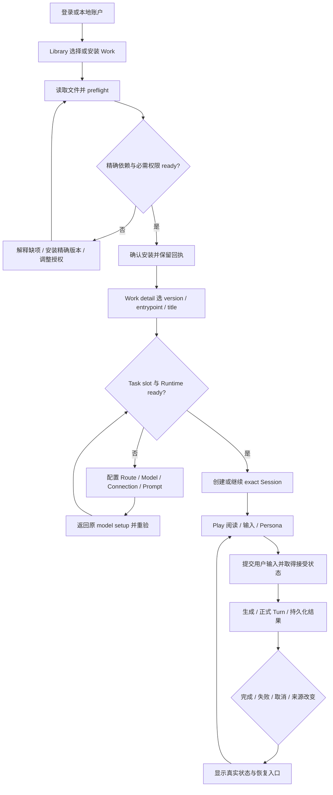
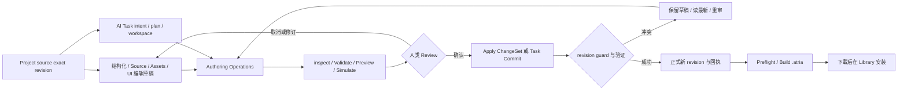
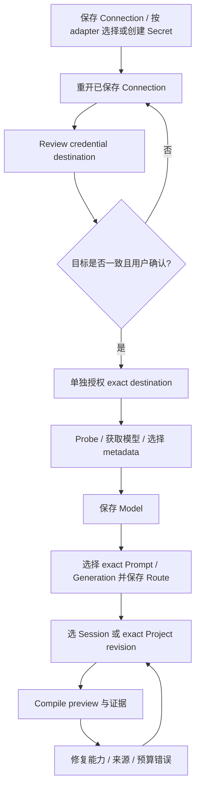

# 完整操作链、状态、审批与恢复说明

本文件结合四份功能清单使用；ID 对应 [Shell/Library/Play](surface-inventory.md)、[Studio/Prompt/Runtime](authoring-runtime-inventory.md)、[Agents/扩展/媒体](agents-extensions-media-inventory.md)、[全局数据工具](settings-storage-diagnostics-inventory.md)。这里描述的是源码静态行为和正式功能约束，**不是已运行验收**；V3/D8 新链单列“目标”。

## 1. 用户与数据对象的关系

| 用户任务／对象 | 来源与真相 | 可以做什么 | 不能混淆的动作 |
| --- | --- | --- | --- |
| 玩家安装 Work | immutable PackageVersion/manifest/dependency closure | preflight、授予所需权限、安装、选择版本和入口 | 安装 ≠ 创建 Session；更新 Work ≠ 更新已有 Session 的 exact version |
| 玩家继续故事 | Session/branch/revision/timeline、正式 SavePoint | 输入、生成、停止、保存、导出、预览历史和显式切分支 | Preview revision ≠ switch；Stop ≠ 撤销已提交输入/副作用 |
| 作者修改资源 | Library identity + immutable revision；Project source/ChangeSet | fork/derive/revise/attach、Review/Apply | 改 Library 当前 revision ≠ 自动迁移 Route/Project/Work/Session 引用 |
| 模型用途配置 | Connection/Secret/Model/Generation/Program/Route 原 Runtime authority | 保存配置、查证能力、单独授权 credential destination、compile preview | 测试连接 ≠ 授权 Secret 发送；保存 Route ≠ 真实请求已通过 |
| Agent 执行 | 当前旧 UI 的 run-state；未来 V3 唯一 Native Host | 原生目标是审阅 Plan、观察 Run/Effect/Receipt、按权限控制 | Browser 草稿/模型文字 ≠ Host authority；新 V3 UI 不是已完成 |
| Memory 与 Knowledge | 原 HCM/Memory provenance、Library Knowledge/World、Actor Cognition 各自权威 | 查来源、纠错、维护、绑定、选择合法受众 | 检索命中/推测/信念 ≠ World Truth；知识修订 ≠ 强制 NPC 得知 |
| 扩展和作品表现 | enabled scope/SDK；Work Source Graph + Host Bridge | 在允许 surface 呈现、调用合法能力 | trusted frontend JS 与 Work sandbox 信任级不同；UI 可见 ≠ Tool/Secret/grant |
| 数据恢复 | Save、ZIP/RecoveryPoint、Resource Center receipt 各自权威 | 先预览和审查，再执行对应 restore | 分支切换、ZIP rollback、回收站 restore、Mask Undo 四者不能共用虚假的“撤销”语义 |

## 2. 主流程图

### F01–F04 玩家首次使用、安装、启动和生成

| 流程 | 操作顺序 | 异常与恢复 | 对应 ID |
| --- | --- | --- | --- |
| F01 进入产品 | 启用账户时选账户或输入 handle/password → Sign in；否则 local account → Learning/当前阅读 | CSRF/连接失败 Retry；注册/OAuth 由 server 配置决定；不是默认保证有公网账户服务 | G05/G07/G09、U01/U02 |
| F02 安装作品 | Works → Install/Update → Choose `.atria` → 看版本、权限、更新差异 → 确认 → Open Work | 必需权限不足不安装；重复点击锁定；成功后打开失败保留安装回执；Cancel 不应伪造撤销既成安装 | L01/L02/L09 |
| F03 启动或继续 | Work detail → 指定 version/entrypoint/title → Start；或精确 Session Continue → task model setup | 缺 slot Route 转 Runtime repair；保存重验后回原操作；Session 已创建但打开失败重用原 id；缺 Work 版本保留进度并修依赖 | L03/L04/L06/L07/L08、R01–R14 |
| F04 输入和生成 | Play 选 Persona → 输入 → Send 或合法快捷键 → 显示 preparing/streaming/finalizing → 正式持久结果 | preparing/busy 防重入；只恢复**未接受**的输入；已接受 user Turn 不重复发；source changed 丢弃过期投影；Stop/取消请求不承诺全部回滚 | Y02–Y05、P03 |

### F05–F08 存档、历史和可复用资源

| 流程 | 操作顺序 | 失败／权限／终态 | 对应 ID |
| --- | --- | --- | --- |
| F05 Save/Load/Import | History & saves → Save/Quick Save 或自动保存设置；Load 指定 SavePoint；Export `.atriasave`；Library Import → preflight/password → Import → Open Session | generation/history/failed/dead 下写入受限；依赖必须 exact；导入前再次 preflight；已导入但 Open 失败不再 Import | Y05–Y07、L02/L06、HISTORY |
| F06 历史和分支 | Find/Explore branch → 看 revisions → Preview/Inspect → 明确 Switch branch 或 Return current；可 rename/archive | Preview 不切当前故事；历史读取失败不改变 active branch；incomplete target 不可 mutate；切 branch 按原 facade 当前性与忙状态检查 | Y08/Y09 |
| F07 World/Knowledge 修订 | Library 类型/资源 → New revision → typed fields/entries/Source → Review → 保存 immutable revision → 查看 history/Used By | 保留旧 exact consumers；解析/类型错误留草稿；删除先列反向引用和跳转；Package 原件先 fork/copy | K01–K09 |
| F08 选择作品资源 | Work/Session resource setup 或 Studio Library references → exact revision → Attach/Update/Fork/Detach → 正式保存/ChangeSet | 选新 revision 与重写 World/Memory/Cognition 无关；detach 的 blocker 要回原消费者修；晋升 Session Knowledge 必须显式、来源有效 | L08/K06/K10、S11/S12 |

### F09–F12 作者编辑、AI 提议和构建

| 流程 | 操作顺序 | 状态与恢复 | 对应 ID |
| --- | --- | --- | --- |
| F09 人工编辑 Project | Open Project → tree 找资源/Source → edit → Review Changes → Changes 检查 exact operations → Apply | dirty 离开保护；inspect 不提交；validation 失败 rollback；409 草稿留在 Changes，可复制/Reload 后重审；成功回执不因 refresh 失败丢失 | S01–S18、S22 |
| F10 AI Project Task | Intent/Create Task → plan/prepare-only/Continue → 看 proposal/checks → Inspect changes → Review & Commit；必要时 Human Takeover | AI 不能替人 commit；blocked/repair/conflict/review 不共用一个“完成”；takeover 触发 abort 但要原 Task 状态确认；不重跑已确认 commit | A01–A04、E01–E07 |
| F11 UI 作者预览 | UI Source Graph → Check source → 定位诊断 → Preview draft；需要正式变更再 Review/Apply | 前端临时表现 preview 不发模型；read-only source 禁写；structured/source 同草稿冲突先处理；不等于 D8 Prompt Draft Preview | S17/S19 |
| F12 作品交付 | 选择入口与 scenario → Validate → Simulation → Preflight → Build/download → Library 安装 → Start Session | simulation 不是实际 Provider 内容质量；build 不是 install；manifest/asset/ref/permission 缺口要定位具体资源 | S19–S21、L02–L04 |

### F13 Runtime 配置和可信预览

无需认证的 adapter 不强制 Secret/credential 授权。Compile preview 使用原 Host exact refs、Context 与 Provider render；不发送生成。不把 preview 失败变成更宽松的 execute，不把旧 source 或 UNKNOWN capabilities 渲染成通过。fallback 另须保持有效 Prompt 语义，当前 E0-01 仍阻塞。对应 R02–R13、Q06/Q07/Q12。

### F14–F21 其他完整操作链

| 流程 | 顺序与跨页联系 | 权限、失败、恢复 | 对应 ID |
| --- | --- | --- | --- |
| F14 Memory 维护 | Agents → Memory → enabled/source/recall → Knowledge/Sources → inspect → 有必要再 correction/history extraction/rebuild | 用原 snapshot.assertCurrent；手工纠错不改故事/World；导入/压缩/rollback 精确范围说明；旧 graph source locate 需原生化 | M01–M08、R11 |
| F15 Feedback→候选→审阅 | 原 Run/Project Task → explicit feedback/collect saved result → target/policy/budget → Eval → paired review → publish/rollback | 真实 profile 来源 `source_unready` 仍 BLOCKED；旧 target 不能冒充 V3 plan-prompt；未来发布按原 D7/V3 CAS，不由 UI 存第二 candidate | E01–E07、原 E0-05/06 |
| F16 Skills/扩展 | Extensions → Skills 安装/编辑/分类/Invocation；或 Plugins install/import → 选择 targets/enabled → Save → runtime activation/status | Package skill read-only；file save expectedSha256；move 不重写 name refs；外部 JS 信任与 Work sandbox 不同；安装/update 不默认启用 | X01–X12、S14 |
| F17 插图与 Media Studio | 启用官方插件/配置 image connection+target/style → Play 选文 annotation → 编辑 prompt/characters → 可选 prompt generation → prepare image → approve → submit → Gallery select → Media Studio mask/edit | task 独立于文本生成；取消需 Host 终态；未知费/外发/降级独立 consent；版本冲突保留原稿；视觉候选分析是可选真实调用 | V01–V12、R03–R05 |
| F18 Shared session | Host live Session enable → owner/session connect → membership/seat/role → participant input → Host commit/cancel → refresh/reconnect | 只读 observer 不提交；persona 仅 seat display；ID 变化断旧连接；不是邀请链接/云共同编辑 | H01–H03 |
| F19 账户备份与同步 | Account → snapshots 或 ZIP scope/preflight/restore/recovery point；LAN 配对/peer/sync/conflict/Undo | Snapshot/Save/ZIP/Sync 不混同；无 terminal receipt 显示未知；LAN Undo 只回退本机；cloud providers 占位不可假连接 | U01–U04、B01–B08 |
| F20 资源清理与故障恢复 | Account/Settings → Storage Center → 选 server/browser/category → detail/blockers → preview → review/execute → progress/history → restore/repreview | 先精确依赖/运行/保留审查；stop after current 不撤已成功对象；unknown/interrupted 先 reconcile/repreview，不能自动扩大删除 | C01–C10、D01–D05 |
| F21 当前旧 Agents 配置与观察（现状，非重构目标） | Agents → Orchestration 选/创建旧preset → agent/graph/raw edit → Validate/Save → scope绑定 → 原RP调用 → Run Timeline/Graph/Stop → Diagnostics/trace replay | 内置项、dirty、import/delete/binding均按旧合同；它是真实consumer，正式V3必须替代后整链清退，不以改名继续兼容；Memory/Goals/Evolution原生能力另行保留 | O01–O08、M01–M08、E01–E07 |

## 3. 必须逐功能落实的状态协议

下表是设计输入和当前实现差异的对照，不新增 API 或状态 Store。每个功能应引用自己的原状态；没有来源的数值写 unknown，不合成假数据。

| 状态／事件 | 用户应看到和能做什么 | 当前依据与边界 |
| --- | --- | --- |
| 首次使用／空／无匹配 | 说明范围、缺什么、可执行的创建/导入；搜索无匹配可清 query | primitives、各域 list；空不等于读取失败 |
| loading／部分来源失败 | 保留定位和现有稿；展示正在读取的对象与部分结果；可重试失败来源 | Library/Studio support/search 用不同来源请求；不把缺数据画成 0 |
| hover/focus/pressed/disabled | 有可感知反馈与键盘焦点；禁用原因可发现；不能靠颜色区分 | 当前 CSS/ARIA 的覆盖见 evidence；本轮无计算样式验证，最终造型交设计 AI |
| dirty／校验失败／Source parse error | 原稿在；定位字段或文件；取消离页继续编辑；不要自动格式化吞文本 | leave-guard、source/prompt/world/knowledge editors |
| saving／重复点击 | 相同操作防重入、busy，成功只认原服务回执 | Studio/Runtime/Persona/preset/extension handlers；非全部旧控件都一致，需重构统一 |
| committed + refresh/navigation failed | 明示保存身份与成功；只重读/打开，不重发 mutation | Library import、Studio Apply/Task commit、Runtime 保存的 receipt 分支 |
| 409/CAS/source stale/host changed | 保留稿或可复制内容；显示 changed scope/revision；重读并重新 review | source editor、Studio、Persona、credential destination；V3 hostBoot/epoch |
| readonly／权限不足／Package original | 能看合法投影，解释为何不能写；给 fork/copy/授权的合法路径 | Library、Skills、History、server logs；隐藏按钮不是安全措施 |
| referenced/running/retained-for-recovery | 显示 exact consumer、去原业务页；不可静默 detach/cascade | ResourceGraph、Storage Center、Persona/Work/Project lifecycle |
| dependency missing／source_unready | 指出缺 exact resource 或受审来源；可修资源；没有来源不能 Eval/Publish | Save dependency recovery；quality.js requirePilotSources 固定拒绝 |
| Provider unsupported／unknown／auth/target denied | 分开错误、合法修复链接；可手填 model metadata 但标 override | runtime-client remediation；credential-target-review；不能自动泄露 Secret |
| 超预算／quota／费用未知 | 显示请求/本地工作/存储各自原因；用户修改合法配置或导出/清理 | Compute、Visual budget、Storage quota 是不同权威；不估算成已付真实费 |
| approval pending／expired／denied | 审什么、哪个 target/source/version、外发/费用/后果、Approve/Cancel；变化即重审 | 当前 credential/visual 各自实现；V3 通用 Effect Approval 尚非完整产品 UI |
| generating／cancelling／late result | 可停止、保留已提交内容；旧 scope 的 late result 不污染新页 | Native Play projection/epoch；Speech/Media 各有任务身份；不把 abort 当远端 rollback |
| unknown dispatch／断线无终态 | 显示结果未确认，查原 receipt/status；不直接重发危险操作 | generation stream 无 result、backup NDJSON、V3 Effect unknown（目标） |
| partial/interrupted/stopped | 列已完成、失败和剩余；只重审剩余；说明哪些能恢复 | Storage Center 的对象级任务；不是所有操作都有原子 rollback |
| Undo/Redo／撤回／restore | 明确对象：editor draft、Mask command、feedback、branch head、recycle identity、account recovery | 各领域自己的恢复协议；不能承诺全局 Ctrl+Z 撤消服务器 effect |

## 4. 快捷键、焦点和 Back

| 操作 | 当前明确链 | 适用范围／注意 |
| --- | --- | --- |
| `Ctrl/Meta+K` | Shell Command toggle | 输入法 composition 不触发选择；结果 Arrow/Enter/Escape |
| Enter／Ctrl/Meta+Enter／Shift+Enter | Native composer `send_on_enter` | 当前 AUTO/DISABLED 普通 Enter 保留段落；启用才 plain Enter send；IME/keyCode229 不发送 |
| `Ctrl/Meta+S` | Skill file editor | 不把它写成所有 Project/Prompt 页的通用保存键 |
| `Ctrl/Meta+Z`／Shift+Z | Mask Canvas command model | 编辑文本原生 Undo 与服务器写入不同；不是整个产品 Undo |
| Escape | Shell 先让 open dialog、More/recovery panel、菜单/Sheet/Command/detail 各层处理；各 editor 处理其局部状态 | 焦点归还触发器；IME Escape 不误关；不可一次穿透退出多层 |
| Sheet grip ArrowUp/Down/Enter/Space | compact context Sheet 可不用拖拽调状态 | pointercancel/lostpointercapture 归位；keyboard 路径功能同等 |
| Navigation grip ArrowLeft/Right/Down、Show navigation | Edge dock 位置与显隐有菜单/键盘替代 | 不要求靠边缘hover或长按才能发现五域；当前表现可在后续视觉方案中重新组织 |
| Android Back resolver | keyboard → modal/popover → context sheet → command → generation handler → detail → full-game → immersive → workspace-child → Atria history → 当前 legacy fallback | 是 handler 有效时才消费的优先链；不是每次 Back 必定取消生成。未来零兼容须替换并删除 legacy fallback，不删前面原生恢复语义 |
| APK Back | Web 先报告 consumed，未消费才 WebView history，再退出确认 | Termux 普通 Chrome 没有 Kotlin bridge，靠 Browser/Navigation Authority；不得用 APK 代码冒充 Termux 已测 |

## 5. 未来新链的表现要求（设计合同，未接通）

- **V3**：Plan draft/validate/publish 与 Run admission 分开；Graph/Inspector 双向编辑；Timeline/Graph 是同一 Host 投影；NodeAttempt、EffectIntent、Approval、Receipt、Result 和 replay/recovery 不共用一个“Run 失败”。各界面按原 V3 合同，不由此文件重定义 payload。
- **D8**：同一 Draft 的 structured/全文无损编辑、authored/effective/provider wire 三视图、exact Diff/来源 Inspector 和手机等价编辑仍是必须覆盖的功能；未发布 Prompt Preview 必须原 Host 可信无发送端口，当前 BLOCKED。
- **D6/D7**：source revoke/branch/actor/grant/time 变化要失效并在消费前复验；来源不完整的质量不能显示“已通过”，文学/Agent/误拒维度保留独立适用性。详细 Gate 仍只归原 [E0](../../refactor/atria-native-prompt-preset-deepening/e0-audit.md)。
