# D9 E1 — Native Orchestration V3 实施工作包、依赖与交接门槛（已冻结路线）

> 2026-10-15 第九轮选择 **E1：内核先行、同一产品任务分支分阶段验证、最终统一零兼容硬切**。本模块独占正式实施阶段/工作包/每阶段退出门槛/创建开发分支的前置条件。接口方向见 [interface-contracts.md](interface-contracts.md)，旧消费者/阻塞静态证据见 [e0-audit.md](e0-audit.md)，验证矩阵唯一来源为 [acceptance-matrix.md](acceptance-matrix.md)。**E0_DESIGN_READY；2026-10-15用户明确授权正式开发，任务分支已基于main@5eb3bc765建立；P1 IN_PROGRESS，最终验收前不集成main**。所有 Stage Gate 是未来真实工程完成条件，不宣称 PASS。

## 1. E1 与零兼容的准确含义

- **内核先行**：优先 Native Host Plan/Run/Effect/Receipt/Snapshot 的逻辑与持久合同，随后图调度、Domain Adapters、RP/Studio/Evolution consumers、U2 UI；每项以真实集成/错误恢复/权限测试为出口，而不是只加接口空壳。
- **一条产品主执行链**：所有开发阶段在**同一个**未来受控产品任务/工作树中推进，旧编排相关模块可以在内部构建过程中暂存用于查消费者，但不能对已完成产品交付生成面向用户的旧、新双执行路径；P6 一次正式 hard cut 后必须无旧模式/桥/UI/数据兼容入口，无 fallback/双读/迁移。
- **无旧数据兼容**：旧 `Single/Spec/Agenda/Loop/Director` mode、配置、Preset、Workspace JSON、Browser IndexedDB Checkpoint、旧 Capsule/Generator 主合同、旧前端交互、旧事件用途和模式化测试均应清退；不将模式转为 V3 示例模板。清理旧配置存储的具体删除点要经过原 Settings/Session 用户数据作用域检查，不删除不属于编排子系统的真实数据。
- **领域权威不能重写**：World、Session/RunControl、Studio/Project Task、Memory/Actor/Hybrid、Model/Provider/Compute、Skills/MCP/A2A、Evaluation/Experience/Evolution 和独立 MCP Plugin 仍保留自己的正式提交/来源/收费/安全边界；V3 是编排调度与结果/Effect 元数据消费者，不是第二 Session writer 或多套计费体系。
- **前端复用 Serene Canvas**：Timeline 默认/Graph 切换、U2 Graph + Inspector 桌面编辑、移动 Node/Edge List + Sheet 语义等价，沿现有 DOM/ESM/Tokens/Primitives/Patterns。Graph 渲染库经局部 PoC 再决定，不能强制整站 React/新主题迁移。
- **不承诺原地不停机迁移旧运行**：老 Run/旧模式不兼容，无数据双轨。具体停机、旧持久状态可删除的范围和未结束旧任务如何明确宣告 unsupported/terminated，要在 E0 的数据和副作用审计中明确；不能借“硬切”丢弃仍可能处于 unknown 的外部操作/正式业务收据。

## 2. E0 设计门槛、开发授权与实施验收三者分离

本节是各 Gate 的唯一前置规则。2026-10-15 用户明确要求消除 E0 与开发授权的循环依赖；这项当前指令修正早期把 V3 实测/三端设备列作建分支前置的条款，D1–D9 的产品语义、E1顺序、零兼容及最终验收要求均不变。

| Gate | 通过所需事实 | 明确不作为该 Gate 的前置 | 当前权限/结果 |
| --- | --- | --- | --- |
| **E0_DESIGN** | 最新 main 的静态消费者范围和未解析动态边界已列明；每项新合同都有原 authority/物理落点/状态机/失败出口/验收责任；没有会迫使实现重开产品方向或复制原服务的未决设计 | 尚不存在的 V3 代码/测试、真实运行trace、crash injection、图backend PoC、三端或MySQL/Pg服务实测 | R01–R07设计已闭合，当前DESIGN_READY，证据见e0-audit §11 |
| **DEVELOPMENT_AUTHORIZATION** | 用户另行明确授权正式产品开发 | 不是测试、环境能力或 E0 设计状态；不能由 Agent 自动推导/设为通过 | **AUTHORIZED**；2026-10-15用户明确授权，任务实现分支已建立 |
| **P1–P6 stage evidence** | 当阶段实现和对应 L1/L2/必要 L4 真实证据；问题诊断修复复测 | 后续阶段尚未产生的最终产品/三端证据不能倒挂为启动该阶段的要求 | P1 IN_PROGRESS，其余按依赖推进；尚未运行的验收NOT_RUN |
| **P7/P8 release evidence** | 全部适用可靠性/安全/域行为、三端L3、四Engine及必要L4证据；当时tested SHA和治理集成条件 | 不以E0 DESIGN_READY、授权、文档提交或fixture替代真实产品验收 | 产品 NOT_VERIFIED / NOT_READY；未测项和真实环境阻塞继续保留 |

**未来创建实现分支的必要且充分前置：E0_DESIGN=DESIGN_READY + 用户新的明确开发授权 + 当时 main delta 未引入新的未决设计。** 不要求先有该分支才能生成的V3实现或验证结果。若main变化只影响工程接线/测试，则更新对应责任项；若改变authority/安全/合同则先补相关设计，不能把所有已通过设计无条件重开。

E0的设计证据清单：

1. main SHA、静态扫描范围/方法、C01–C18与151文件manifest、未解析动态加载和外部安装边界明确；每类consumer都有删/留/抽离/替代及P4/P6实测责任。
2. Plan/Binding/Run/GraphPatch/Effect/Receipt/Approval/Result/Projection具备严格身份、原生key/存储/CAS/恢复/RPC和错误合同；原服务扩展位置明确，无第二World/Context/收费/Secret writer。
3. Host排他、普通RP预算、Output原consumer幂等、Evolution发布、可信批准、SQL commit unknown、UI三端这些**工程设计本身**已有确定的实现策略或范围内默认拒绝策略，不能只写“以后决定”。
4. 每个设计项映射到真实实施阶段、验收case、失败恢复/不开放条件；测试没有运行就保持NOT_RUN，设备/账号实际不可用则对应验收BLOCKED。
5. 当前明确开发授权已满足；最终验收通过后才集成main。授权不改变数据保护/旧编排零兼容及未测不称PASS的约束。

唯一详细接口仍归 [interface-contracts](interface-contracts.md)，R01–R08拆分、设计核销与最终结论归 [e0-audit §11](e0-audit.md#11-r01r08-设计与实施证据分账)。

## 3. 正式实现工作包（E1 阶段顺序）

| Stage | 主工作包与需复用的权威 | 可验收出口（不通过不得标 PASS） | 前置依赖 |
| --- | --- | --- | --- |
| **P1 — Host Foundations** | Native PlanDefinition/Draft/Publish/CAS、RunLedger/Checkpoint/TaskGraphRevision/RunIdentity/NodeAttempt、Storage/GC/可授权 Host RPC；保持纯 JS 逻辑与 Node Server 分离 | 真实 Native FS/SQLite 启动、并发/崩溃/重开、不可变 Plan、CAS/fencing/新旧来源；无 Browser 可执行权威 | **E0_DESIGN_READY + 用户另行正式开发授权（§2）** |
| **P2 — Graph & Effect Core** | G2 GraphPatch/Delegate/Handoff/Fanout/Join/Planner/Judge/Review、S2 EffectIntent/Approval/EffectReceipt/unknown/reconcile、D3 重试/循环、Host Scheduler permits | 动态/并行/晚到/CAS 重放、写前 WAL 或等价保证、非幂等外部未知不重复发送、取消与费用真相分开 | P1 Host identity/ledger |
| **P3 — Native Ports & Budgets** | D4 唯一 Hybrid/Context/Actor、D5 Model Routing/Compute 原预算/Provider fallback/Reuse、Tool/Skill/MCP/A2A Secret/Egress 权限、原业务 DomainReceipt refs | Owner/Actor/Source 隔离、预算原子预约和重启、实际 Provider/Tool attempt 与 Unknown、没有影子收费或第二 Memory/Secret/Business writer | P1/P2 |
| **P4 — Product Consumers** | Native Game/Ordinary RP Narrator/Player autonomy、Session World/Command/Timeline、Studio Project Agent Task/Review/Apply、Experience/Evolution targets 与原 M1 Eval | 单次合法正文、无玩家代写/全知硬写越界；Studio 只审阅后获准正式提交；`evolution-targets.js` 等旧模式引用已替换且原记录可信 | P2/P3 |
| **P5 — U2 Frontend** | Serene Canvas Agents Plan Library/Graph+Inspector/typed Ports/Draft/Publish，Run Timeline 默认/Graph 切换、Host Projection/Diagnostics/Approval/Source/Cost 与移动端 List/Sheet | Canvas/List 双向、版本冲突/错误定位、无编排 Browser Runner、真实审批/Control 流，PC/Mobile 交互与权限隔离 | P1–P4 新权威 API 与可信 UI contract |
| **P6 — Atomic Legacy Hard Cut** | 同任务分支一次性切换全部 RP/Native Game/Studio/Agent/Search/Shell/Evolution 的原生入口，删除旧五模式/编排代码/Browser checkpoint/旧 preset UI/旧 mode 事件注入/专用测试 | 静态 import/路由/设置/持久数据/用户入口全面无旧编排活引用；旧数据不迁移/无 fallback/shim；共享 Native/Message Takeover 非旧用途仍正常 | P1–P5 替代已准备与真实消费者闭包 |
| **P7 — Integrated Acceptance** | [验收矩阵](acceptance-matrix.md) 中 Graph/权限/预算/质量/安全/崩溃与三端分层实测，本地相关检查/实体客户端证据和必要缺陷修复 | 各 Gate PASS 的测试名、Head、原始输出/账号权限、真实负例和误差记录；无法验证的高危矩阵项阻断产品完成 | P1–P6 |
| **P8 — Integration & Close** | 检查干净分支与产品相邻任务最新变化、真正 main 集成/推送、docs 同一 Record 更新 End/Tested HEAD、清理安全旧分支 | 无未合并活工作、相关回归/真实平台证据、最终源头/状态明确；不得未经测试/确认称完成 | P7 与 Governance |

**依赖允许安全细分/局部穿插**：如 P3 可先实现合法只读 Context Port 以支持 P2 测试，UI 合同可在 P1 用无副作用 Stub 测试，但不得把此类穿插解释为提前达到完整阶段 Gate。阶段结果与真实失败留同一 Record，常规工作可在**已授权实现后**按 Governance 持续推进。

## 4. 接口与清退专项工作包映射

| Workstream | 需要补全的真实依赖 | 阻断的阶段 |
| --- | --- | --- |
| **W01 Authoring/Data** | 旧 `agentWorkspace`/SettingsRepo CAS、PlanDefinition/Revision、版本和源资源、旧数据 no migration/旧私有缓存清理 | P1、P6 |
| **W02 Host Ledger/Recovery** | Native Scheduler/RunControl/FS/SQLite、原 charge attempt、effect operation identity、unknown/crash-reconcile、独立 MCP Journal 边界 | P1–P3、P7 |
| **W03 Graph/Core** | 旧 `agent-runtime/orchestration-engine` 纯函数可提炼范围、G2 Node/Join/GraphPatch、所有 mode 依赖清除 | P2、P6 |
| **W04 Source/Context/Compute** | Actor/Memory/Hybrid/Information/World、Provider/Route/Budget/Local Work、source revocation/ref validity | P3、P7 |
| **W05 Tools/Security** | Skill/MCP/A2A Tool discovery/grants、Secret/Endpoint/Approval、Plugin host/native domain ports、外部未知任务 | P2–P3、P7 |
| **W06 RP/Game Consumer** | `capability-host.js`、`native/play-generation.js`、`experience/llm/*`、旧 Director 旁白和 Message Takeover 用途，原 World/Turn/Output | P4、P6 |
| **W07 Studio/Evolution Consumer** | `project-agent-executor.js`、`project-agent.js`、Studio Review/Commit、`evolution-targets.js` 与 Prompt/Strategy Preset target 重构 | P4、P6 |
| **W08 U2 UI & Shell** | `atria-shell/workspace-host.js`、Shell Search、Graph viewer、旧 Workspace Panel、Serene Canvas/手机输入与审批 | P5–P7 |
| **W09 Hard Cut & Evidence** | 旧模式/适配/JS/CSS/测试/配置导入一一核对，关键信息迁移仅正式业务权威引用、真实数据不被误删；三端验收证据 | P6–P8 |

早期 E0 仅部分静态确认 W01/W03/W06/W07/W08；本轮静态盘点与物理合同增补见 §6–8，真实运行闭包/E2E 仍需补证，[e0-audit.md](e0-audit.md) 记录 evidence，不将设计目标当已完成代码改动。

## 5. 分支与正式开发门槛

Gate只由 §2 管理；此处不重复另一套前置。当前用户**已明确授权正式开发**，本任务在`refactor/atria-native-orchestration-v3`同一工作树连续推进P1–P8，不逐阶段重新索权；最终验收通过后才集成main。

缺三端设备/外部账号/MySQL或Pg服务，影响对应实施验收的可执行性和交付，**不使已冻结设计倒退为E0 BLOCKED**；缺真正authority/无法定义失败出口才属于E0设计阻塞。若真实测试失败暴露合同缺陷，应在受影响阶段修设计/实现并复测，不伪称E0已验证该功能。

## 6. E0 收口后的依赖图与阶段增补

本节把 §3–4 已冻结的 E1 路线落到物理接口 v1，不改变 P1–P8 顺序。当前 E0 设计状态见 e0-audit §11，**实施已获授权，P1进行中**。未来开发前先重读实际 main delta、同一 Record、[consumer inventory](e0-consumer-inventory.md) 与 [AST graph](e0-import-graph.md)，不能直接删除 151 文件。

```mermaid
flowchart LR
  E0["E0_DESIGN_READY"] --> AUTH["用户另行正式开发授权"]
  AUTH --> P1["P1 Plan / Ledger / Store / Owner"]
  P1 --> P2["P2 Graph / Effect / Approval 状态机"]
  P2 --> P3["P3 原 Domain Ports / 预算 / Send"]
  P3 --> P4["P4 RP / Game / Project / Evolution"]
  P4 --> P5["P5 U2 / Projection / 可信审批"]
  P5 --> P6["P6 全入口统一硬切"]
  P6 --> P7["P7 故障 / 安全 / 三端验收"]
  P7 --> P8["P8 main 集成与交付"]
```

| 阶段 | 必须拿到的具体输入/交付 | 最小 Gate 与禁止跨越的事实 |
| --- | --- | --- |
| P1 | interface §6/7：6个编排kinds + 原HostFence/RPControl的key validators、原 canonical hash、Plan Draft/publish、Run/records/command tx、SourceBinding、Host writer exclusivity、backup/GC ref registration；RPC auth/CSRF/boot/read-only | FS+SQLite 的新 kinds/insert/CAS/immutable、并发 publish、第二 Host 拒绝、损坏与 ACK-loss 的 L1/L2；MySQL/Pg注册/adapter L1合同不得漏；真实SQL连接Owner/故障证据在启用该backend发送前取得，最终P7四Engine验收必须齐备。没有相应backend的P1 V3证据就不在该backend接外部Effect |
| P2 | 同一 Run CAS 下 GraphPatch/Join/Delegate/Handoff/Review/counter；prepared/ready/dispatching/unknown、Approval binding/consumption、取消与 late receipt | 仅受控 test Port 验状态机/崩溃窗口，**不接真实付费或外部 mutation**。BudgetPort 用合同 fake 不计为原预算通过；可信 UI 尚未存在时 approval mutation 不对生产开放 |
| P3 | W04/W05 改接原 BudgetPort、稳定 provider attempt 与 fallback、Context/Hybrid audience、Tool/MCP/A2A/Skill/Egress/Credential Ports、原 DomainReceipt | sibling 竞争、跨 tx unknown、原bank三域Session/Project/RP的observe/settle、source revoke before send、zero duplicate charge、无可用 bank 的普通 RP 拒绝。有真实服务准入的 L4 才能称其外部费用/协议通过 |
| P4 | C02/C03 新 consumer；W07 Target 全生命周期+Eval adapter/worker/fingerprint；普通 RP chat source 与 Session/Project 各自 output consumer；Skill 旧 scope 替代准备 | 一个 source turn/variant/slot 唯一 output；World/Project commit 与 Run completed 区分；新 evaluator 身份/旧报告不可发布。旧实现可尚在任务树供静态对照，但新主链不能调用旧 runner |
| P5 | Host projection/long-poll、Plan Library、Canvas+Inspector/List 同 Draft、可信 Approval 详情、Source/Cost/Unknown/Diagnostics、Shell/Search 移动路由 | 新 UI 在真实 Host/Browser 验 L2；取消/status 不被模型/图布局/审批等待阻塞。图 backend PoC 须留键盘/触控/负例/测量；DOM/ESM/原 token 与当前主题 authority 保持一致 |
| P6 | C01–C18 全面切入口、卸旧 subscriber/worker；清 151 文件中旧执行路径、旧 scope/config/UI/assets/checker/tests；修共用 helper imports；旧客户端发送协议失效 | AST+语义扫描零生产旧根/旧 API/mode/scope执行路径；非目标 sync/World/Studio/Memory/Skill 不误删；真实 boot/Game/Settings/Shell/Evaluation/Skills trace。旧 private data 无迁移/别名/双读，历史正式收据保护 |
| P7 | acceptance 全部适用 G/S/UI/平台用例和失败复测；测试准确 product SHA/设备/存储后端；安全开放文本评价与工程证明分开 | L1/L2 + 三端 L3 + 必要且获准 L4；任何高危 BLOCKED 不能算全域完成。按 Governance 运行本地相关检查，不新增等待远端 Actions 的条件 |
| P8 | 锁定 tested SHA、对照 main 增量、冲突修复相关复测、同一 Record End/Tested HEAD、最终 docs 与集成状态 | P7 通过且符合原 Governance 才集成；仅相同已验证内容不重复全量测试；活跃未完成分支/用户内容不清理 |

P2 不需要提前实作一套影子预算；P3 的预算接口合同在 P1/P2 先固定，真实 authority 接入在 P3 验证。P5 的 UI 原型可以在 P1–P4 用无副作用数据并行推进，但不能提前把阶段 Gate 改成 PASS。P6 之前不发布含新旧可选择入口的产品版本；最终切换失败在同任务修复，不保留旧模式回退。

## 7. W01–W09 物理交付与依赖清单

| 包 | 源码 authority / 依赖输入 | 具体产物与完成证据 | 先后约束 |
| --- | --- | --- | --- |
| W01 Authoring/Data | Native contracts/identity/common + 原 Settings/Skills repo | 6个编排kinds中的Plan/Binding/revision及原Storage/RunControl域新key注册、Draft/publish API、严格 validator/hash；Settings old subtree、orch-preset 读写/restore 禁止重启旧协议；精确数据清单 | P1 authoring 先于 W08；硬切清理等 W06/W07/W08 替代齐备 |
| W02 Ledger/Recovery | Engine/原 journal、SQL Native CAS、RunControl、ProjectTask、Storage refs | RunRoot/record/command tx、§12 root guard/SQL session Owner与HostFence、host epoch、恢复扫描、GC pins、write-before-send saga；不是新 World/费用银行 | P1 基础；W04 预算身份规范须先对齐；P2 使用 fake Port，P3 才真实 send |
| W03 Graph/Core | W01 immutable Plan + W02 CAS/epoch + D3 | typed graph/whole patch、JoinReceipt、delegation/return、bounded counters、Review invalidation；抽离 prepared-context/envelope 共用 helper | P2；C08/C09 抽离先于任何旧目录删除 |
| W04 Source/Context/Compute | 原 Context/Hybrid/Information/Actor、GenerationHost/Model Route、RunControl/Project bank | SourceBinding/audience refs，原 authority reservation tree+stable attempt admit/observe/settle，fallback/unknown/parent high-water；§13原RunControl RPControl/controlId与稳定send identity，不再只以缺authority拒绝占位 | P3 真实接入；P4 output/currentness 前置；预算树不得由 W02 私有实现 |
| W05 Tool/Security | 原 Tool/Skill/MCP/A2A/CredentialTargetAuthority/SecretPort + W02 intent | action descriptor/version/hash/grant/egress，审批 challenge/一次消耗、真实Port reconcile、§15同Host独立Review Origin/原用户再认证、禁无保护R3；删旧 registry tools/scope hook | P2 合同→P3 Ports→P5 可信 UI；SDK 不能拿批准 capability |
| W06 RP/Game | W03–W05 + Session/World/Command/原ChatRepo/RPControl单输出consumer | capability boot/play-generation/experience runtime/narrative/rewrite 全部接新 contract；§14 writing单permit/单chat正文+marker/原DomainReceipt；旧 mode/guidance/takeover subscriber 下线 | P4 业务→W08 展示→P6 移除旧主链 |
| W07 Project/Evolution | 原 Studio/ProjectTask/Experience/Eval、W01 exact Plan refs、W03–W05 | Target authorize/catalog/capture/prepare/check/current/write/discard/evaluationSettings、Eval adapter/worker/fingerprint、promotion/rollback 原权限；旧 report 不自动 eligible | P4 业务；先替 evaluator/指纹/Settings CAS 消费，再删旧 presets/Director |
| W08 UI/Shell | W01 authoring + W02 projection + W05 trusted interaction + W06/W07 | Graph+Inspector/完整移动 List、Timeline 默认/Graph toggle、Source/Cost/Approval/Diagnostics、Search/deep-link/history/Back；旧 panel/CSS/labels 消除 | P5；原 Serene Canvas/Settings Theme 只引用不另建；真实功能等价后进 P6 |
| W09 Hard Cut/Evidence | C01–C18、两个审计附件、所有工作包替代接口 | 逐路径处置核对、AST/语义零旧执行引用、测试适用性分类、三端/Store/服务 evidence manifest、main delta复核 | P6 清退→P7验证→P8集成；不得把 grep 无命中等同端到端通过 |

已有测试复用入口见 acceptance §8；新 `tests/native-orchestration/` 在当前已授权任务分支建立。不能原样搬旧 mode/preset/recovery suite 后改名，必须验证新的 Host 权威和原 Domain receipt。

## 8. 同期领域方案边界与最终开发就绪复核

- [Storage Center](../atria-storage-center/index.md) 负责统计/完整对象闭包/回收站/原 ID 恢复。V3 注册 kinds/ref roots/active-run/unknown 效果保护，不能另造清理中心或用其“恢复”自动续跑、重发/返还费用。
- [Settings/Themes](../atria-settings-and-themes/index.md) 与 Serene Canvas 管通用设置保存、主题和 Shell 视觉；它的通用兼容不恢复 D2 已废止的 Orchestrator subtree/mode/scope。V3 只清旧编排字段，新 Authoring 不重复实现 Settings 服务；当前主题更新不要求 V3 强制固定浅色。
- 既有独立 MCP、Model/Memory、Game Runtime/Project、Experience/Eval 方案仍各持权威。未来 main 上同期改动先做精确 diff，不读取其它任务未提交草稿或把历史源基线当当前实现。

本轮当前核销/设计就绪与实施证据分账见 [e0-audit §11](e0-audit.md#11-r01r08-设计与实施证据分账)；§10保留先前尚未分账时的历史结论。用户已于2026-10-15另行明确授权正式开发；E0设计和授权均满足，产品实现与验收仍独立留证。这里的交接结论是企划收口产物，不创建/刷新独立 HANDOFF，不将未完成验证转交为已完成。
